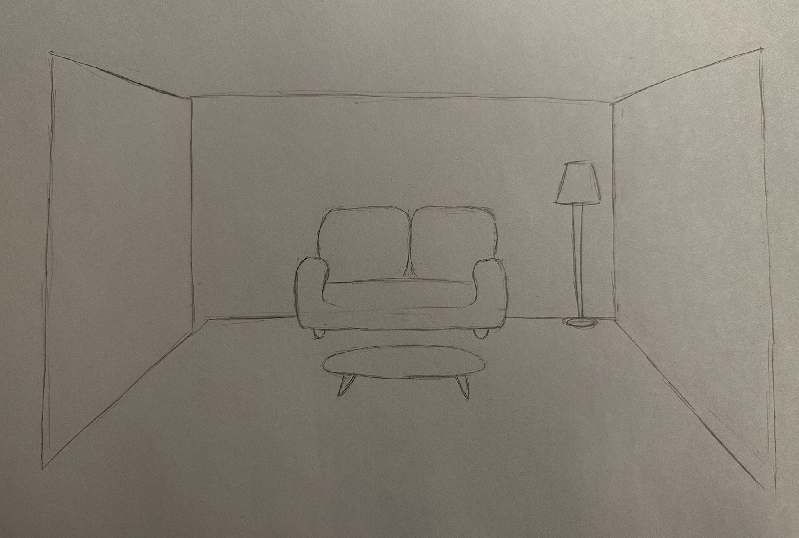
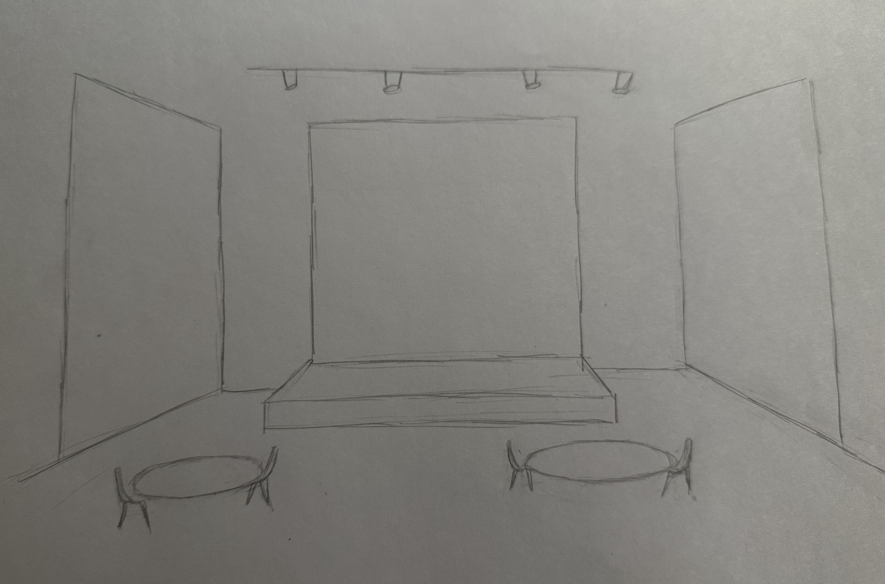
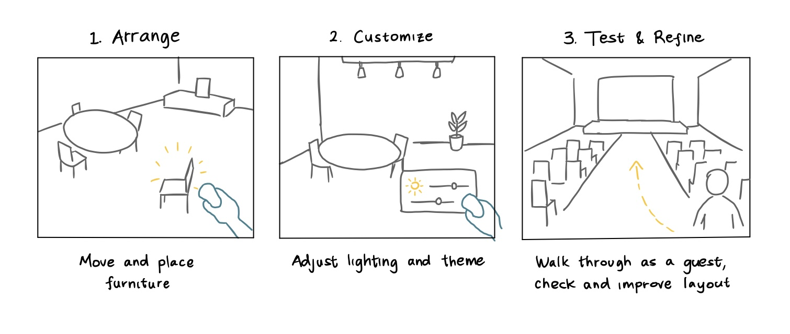

# Design Activity

## Initial Idea

My initial idea was a VR room-planning application where users could enter a virtual room and arrange different furniture to create their preferred setup. The main idea was to let users directly grab, move, and rotate furniture instead of arranging everything through a normal 2D screen. I thought this interaction would work well in VR because users could experience the room at a more realistic scale while deciding where each item should be placed.

## Paper Prototype and Early Exploration

To explore the idea, I created a simple paper prototype and sketch of the room-planning concept. The prototype helped me think about how the user would interact with the space, such as selecting furniture, placing it in the room, and moving around to review the arrangement. While developing this prototype, I started thinking about other situations where the same type of spatial interaction could be more useful.

## Developing the Event Planning Idea

From the room-planning concept, I developed another idea that applied the same interaction to an event venue. Instead of only arranging normal household furniture, users could arrange event elements such as tables, chairs, a stage, a registration desk, and decorations. I felt that this gave the original idea a more specific purpose because the user would not only think about how the space looks, but also how the venue feels and functions from a guest’s perspective.

I created another sketch to show how the idea could work in an event-planning context. In this version, the user could arrange the venue, customize the setup, and later walk through the space from a guest’s perspective.

## Participant Feedback

I showed both the room-planning and event-planning concepts to participants using my sketches and paper prototype and asked which idea they found more interesting. Most participants preferred the event-planning concept because they felt it was more distinctive and had a clearer purpose than a general room-planning application.

Based on this feedback, I decided to continue with the event-planning direction and started thinking more about how being inside the virtual venue could make the planning process more useful.

## Refining the Final Concept

After choosing the event-planning concept, I refined the interactions further. I kept the original idea of directly grabbing, moving, and rotating objects, but added more event-specific tasks. The final concept focuses on three main activities: arranging the event layout, customizing the event setup, and testing the venue from a guest’s perspective.

I also started using Cvent Event Diagramming as a reference because it already supports event layout and venue planning. My VR concept builds on this type of application by allowing users to interact with the venue more directly and experience the layout at approximately real-world scale.

This process helped develop my original room-planning idea into a more focused VR event-planning application where users can not only design the space, but also experience and review their decisions before the real event is set up.

## How the VR Experience Would Work

In the final concept, the user would first enter an empty or partially prepared event venue and arrange the main elements by grabbing, moving, and rotating objects such as tables, chairs, a stage, and decorations.

Once the basic layout is created, the user could customize the setup by adjusting table styles and lighting, as well as repositioning decorative elements. After this, they could move through the venue from a guest’s perspective, for example from the entrance to the registration area, seating area, and stage.

If they notice that a pathway feels too narrow or the stage is difficult to see from a certain position, they can return to the layout and make changes. This creates a simple cycle of arranging, customizing, reviewing, and refining the venue rather than treating the walkthrough as only a visual experience.

